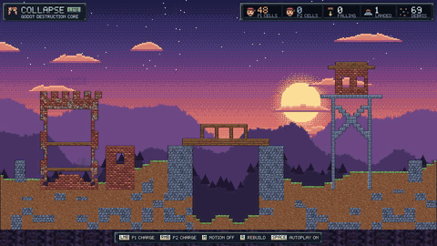

# Godot Destruction Core Lite: 2D destruction and collapse for Godot 4 (free, MIT)

**Free, MIT-licensed, deterministic 2D destruction for Godot 4: destructible cell terrain, damage shapes, single
detonations and structural collapse with falling pieces, rubble and crush damage.** Pure typed GDScript, Web-export safe.

[](https://godotengine.org) [](LICENSE) [](tools/run_tests.sh)

- **Version 0.2.1** · **Engine:** Godot 4.6+ (tested on 4.7.2) · **Language:** typed GDScript · **Licence:** MIT
- **Tests:** 76 headless tests (`bash tools/run_tests.sh /path/to/godot`)
- **Website:** https://openclawaimac.github.io/godot-destruction-core/ · **Pro edition (chain reactions, fire, stress, mask import, debug overlays, replay, Fire Sale demo; 133 tests):** https://huginhelm.itch.io/godot-destruction-core
- **For AI agents:** [AGENTS.md](AGENTS.md) · [llms.txt](llms.txt)



## Quickstart
```bash
git clone https://github.com/openclawaimac/godot-destruction-core-lite.git && cd godot-destruction-core-lite
godot --headless --path . --import          # once: registers the DK* classes
bash tools/run_tests.sh /path/to/godot       # expect 76 tests, "CI: all green"
godot --path .                               # run the "Collapse" demo
```
To use it in your game, copy `addons/godot_destruction_core/lite/` into your project. See [QUICKSTART.md](QUICKSTART.md).

## Lite vs Pro

| Feature | Lite (free, MIT) | Pro (commercial EULA) |
|---|---|---|
| Cell grid, materials (integer hp, resistances, anchors, rubble), damage shapes with falloff | ✅ | ✅ |
| Single detonations, budgeted scheduler, signals | ✅ | ✅ |
| Determinism: integer state, SHA-256 digest, snapshot/restore, per-player instigator credit | ✅ | ✅ |
| Structural collapse: resumable support check (no size cap), falling pieces, rubble, crush damage | ✅ | ✅ |
| Debris pool, basic feel (shake, once-per-chain hitstop, reduced motion) | ✅ | ✅ |
| TileMapLayer renderer, per-chunk merged collision | ✅ | ✅ |
| Demo UI kit: own pixel font, styled HUD, comic callouts (MIT) | ✅ | ✅ |
| Chain reactions (`DKChainReactor`): fuses, merging, per-tick budget, runaway caps, barrels/triggers, explosive materials | – | ✅ |
| Fire (`DKFire`): deterministic spread, burn-out to ash/charcoal, burnt supports collapse, flames light barrels | – | ✅ |
| Load-based stress (`DKStress`): shear and crush failure, budgeted sweeps, analysis-only heat map | – | ✅ |
| Image/mask import (`DKMaskAdapter`): alpha or palette images to the grid, mask carve stamps, grid to image | – | ✅ |
| Debug overlays: chain graph, stress heat map, "why did this fall?" inspector, frame-budget HUD | – | ✅ |
| Command log and replay (`DKCommandLog`): record, replay to an identical hash, checkpoints, save/load | – | ✅ |
| Demos | "Collapse" (2 local players) | + "Fire Sale" run-and-gun demo (O = debug overlays) |
| Web builds (HTML5 export presets) | Collapse | + Fire Sale |
| Headless tests | 76 | 133 (76 Lite + 57 Pro) |
| Licence | MIT | Commercial per-seat EULA |

Pro keeps the same API: drop `addons/godot_destruction_core/pro/` next to `lite/` and attach the modules.

## Layout

```
addons/godot_destruction_core/lite/   DKMaterial, DKMaterialSet, DKDamage, DKReport, DKCellGrid, DKScheduler,
                                      DKWorld, DKSupport, DKPieces, DKDebris, DKFeel, DKTileRenderer, DKChunkCollision
demos/common/                         shared demo UI (pixel font, HUD, callouts)
demos/lite_collapse/                  the "Collapse" demo + procedural art generator
tests/                                headless runner + lite suite
tools/run_tests.sh                    strict runner (wraps ci/run_tests.sh)
```

## Determinism and multiplayer readiness

- Integer HP, integer power, and integer percent resistances. No floats in the state that gets hashed.
- Cells are visited in row-major order, and dirty chunks come out sorted. Nothing iterates over hash order.
- No global RNG. Fuse jitter is an integer hash of the cell position.
- Queues are ordered by `(due_tick, seq)`. Count budgets are deterministic. Microsecond budgets only apply
  when `DKScheduler.deterministic = false` (cosmetic work only).
- There is no single "player". Every `DKDamage`, detonation and `DKReport` carries an `instigator_id: int`
  (0 = world/unknown). Chains inherit the instigator of the blast that lit them, and
  `DKWorld.instigator_stats` attributes destroyed and damaged cells and detonations per id.
- `state_digest()` (SHA-256) and `state_hash()` cover the grid, the tick count, the router state, pending
  support work and falling pieces, so two peers or a replay can be compared. No networking is included.
- Collapse is integer and order-fixed: support seeds are FIFO in grid order, the flood fill has a fixed
  neighbour order, falling pieces use 1/256-cell fixed-point speed. Pieces, rubble and crush damage carry the
  instigator id of the damage that cut them loose. Debris and feel are cosmetic but still hash-driven
  (no global RNG), so `DKDebris.digest()` matches between runs.

## Lite API

### DKMaterial (Resource)
`id, hp:int, density, strength, solid, anchor (indestructible), falls, resist {type: percent},
blast_radius, blast_power, debris_color, debris_count, sound_class, rubble_into, rubble_pct`
- `anchor` or `falls = false` cells count as ground for collapse.
- `rubble_into`: material a landed piece becomes; `rubble_pct` (0..100) of its cells do (hash-chosen; the
  bottom row always does), the rest keep their material at half hp. Short drops never turn into rubble.
- `DKMaterial.make(id, hp, extra := {})`
- `damage_after_resist(power:int, type) -> int`

### DKMaterialSet (Resource)
Index 0 is always empty air. `make(list)`, `size()`, `at(i)`, `index_of(id)` (-1 if unknown).

### DKDamage (RefCounted)
Shapes: `circle(pos, radius, power, type, instigator_id)`, `rect(pos, size, power, …)`,
`line(from, to, width, power, …)`, `cell(pos, power, …)`, `cells(indices, power, type=&"crush", …)`,
then `with_falloff(min_pct)`.
Fields include `type`, `instigator_id` and `tag`.

### DKReport
`destroyed: PackedInt32Array` (cell indices), `destroyed_mat` (their former materials), `damaged`,
`damaged_cells` (cells hit that survived), `blocked`,
`by_material`, `instigator_id`, `damage_type`, `tag`.

### DKCellGrid (RefCounted, packed arrays)
`setup, load_rows(rows, legend), in_bounds, index, coord, world_to_cell, cell_center, is_solid,
material_at_cell, set_cell, set_protected, solid_count, cells_in(damage), apply(damage) -> DKReport,
paint(damage, mat_index), take_dirty_chunks(), mark_all_dirty(), digest(), state_hash(), to_dict(), from_dict()`

### DKScheduler (RefCounted)
Per-frame work queues with budgets: `add_queue(name, fn, count_budget, usec_budget=0)`, `set_budget`,
`push(name, item, dedupe=true)`, `tick() -> {name: processed, "overflow": {name: pending}}`, `flush`, `clear`,
`pending`, `total_pending`, `stats`. Overflowing work is deferred to the next tick and never dropped.

### DKWorld (Node2D)
Exports: `materials, grid_size, cell_px, chunk_cells, rebuild_budget, auto_tick, collapse_enabled,
support_budget (cell visits per tick, default 4096), bottom_is_ground, ground_edges` (extra grid edges that
count as ground: `DKSupport.EDGE_LEFT | EDGE_RIGHT | EDGE_TOP`).
Positions are in the node's local space.

| Method | Purpose |
|---|---|
| `setup(w, h, cell_px, chunk_cells, materials)` / `load_rows(rows, legend)` | build the grid |
| `apply_damage(d: DKDamage) -> DKReport` | carve/damage cells |
| `detonate(pos, radius, power, type=&"blast", instigator_id=0, fuse_ticks=-1) -> Dictionary` | blast. Immediate without a router (`det["report"]`); otherwise routed |
| `execute_detonation(det) -> DKReport` | performs a blast now (used by routers) |
| `paint(shape, material_id) -> int` | fill cells |
| `is_solid_at(pos)`, `material_at(pos)` | queries |
| `tick()` / `flush()` | advance one step: router tick, support check (budgeted), falling pieces, then dirty chunks and budgeted rebuild requests |
| `check_all_support()` / `settle(max_ticks)` | check every cell after loading / tick until no collapse work is left |
| `state_digest()`, `state_hash()` | determinism checks |
| `snapshot() -> PackedByteArray`, `restore(bytes) -> bool` | full state including router, instigator stats, pending support work and falling pieces. Bad data is rejected |
| `set_detonation_router(obj)` | install a router (e.g. Pro) |

Signals: `cells_damaged(report)`, `cells_destroyed(report)`, `cells_painted(shape, id, count)`,
`detonated(det, report)`, `chunk_rebuild_requested(chunk: Vector2i)`, `budget_overflow(queue, pending)`, `ticked(tick)`,
`piece_detached(piece)`, `piece_moved(piece, from_rect, to_rect)` (crush your entities here),
`piece_landed(piece, crush: DKDamage, impact)`, `piece_lost(piece)`.

### Collapse: DKSupport + DKPieces (RefCounted, owned by DKWorld)
- **DKSupport**: destroyed cells seed a flood fill over their solid neighbours (depth first, "down" first). A fill
  that reaches an anchor (or the bottom row) is supported; one that runs out of cells is an unsupported region.
  Fills are resumable, so a region of any size is found over several ticks within `support_budget` visits per
  tick; there is no size cap that would treat big regions as anchored. Results are cached per pass (no
  destruction since), painting restarts an unfinished fill, landed rubble is re-checked. Only `solid` materials
  connect: non-solid cells (background walls, ladders, decor) neither hold anything up nor fall.
- **DKPieces**: an unsupported region is lifted out (split into 4-connected components) and falls straight down
  with integer gravity (`gravity`, `max_speed` in 1/256 cells/tick), swept cell by cell (never tunnels). On landing
  it is written back (rubble rules above) and the cells under it take `crush` damage
  (`crush_power(piece, impact)`, from speed and mass, none below `crush_min_speed`) credited to the piece's
  `instigator_id`. Pieces don't collide with each other in the air and only solid cells block them.
  `hold_ticks` (default 0) keeps a detached piece still for that many ticks first (a "creak" before the drop).
  Piece dictionaries: `id, x0, y0, w, h, cells, mats, hps, bottom, fy, vy, mass, instigator_id, hold`.

### Adapters (thin; they only listen to DKWorld signals)
- **DKTileRenderer** (TileMapLayer): `atlas`, `tile_px`, `material_rows {id: row}`, `variants`, `damaged_below_pct`;
  `bind_world(world)`, `rebuild_all()`. Atlas row per material: 16 neighbour-mask columns (bits up=1, right=2,
  down=4, left=8) intact + 16 damaged, repeated per variant. Falling pieces are drawn with the same tiles.
  `macro_tiles {id: Vector2i(px, py)}` makes a material pick variants by position, so one seamless
  (px*tile) x (py*tile) texture sliced into variants tiles with no visible grid.
- **DKChunkCollision** (Node2D): one StaticBody2D per chunk with greedily merged RectangleShape2Ds;
  `merge_rects(grid, chunk)` is pure and covers exactly the solid cells.
- **DKDebris** (Node2D): `capacity` (hard cap, ring buffer), `max_per_event`, `reduced_motion`; chips for destroyed
  cells (material `debris_color`/`debris_count`) and dust for landings; `step()`, `digest()`.
- **DKFeel** (Node): trauma shake (sets `camera.offset` or emits `shake_changed`), `request_hitstop(ms, chain_key)`
  granted once per chain key, capped by `hitstop_max_ms` and a cooldown, optional `Engine.time_scale` slow-down,
  `reduced_motion` (no shake, no hitstop). Reacts to `detonated`, `cells_destroyed` and `piece_landed`. Uses the
  Pro chain id when present in `det["chain"]` (generic key; Lite does not depend on Pro).

## Lite demo: "Collapse" (`demos/lite_collapse/demo.tscn`, main scene)

Two local players drop charges on a valley with a hollow brick keep, a timber bridge over a chasm and a steel
watchtower. LMB = P1, RMB = P2, M = reduced motion, R = rebuild, SPACE = autoplay (runs until the first click).
Styled HUD (9-slice plates, stat chips with icons, key-cap hints) in the kit's own bitmap pixel font, plus
popping comic callouts on blasts and crashes, all from the shared MIT demo UI in `demos/common/`
(`DemoPixelFont`, `DemoUIArt`, `DemoHud`, `DemoCallouts`; no font or image files). Only Lite classes are used.
Screenshots: `docs/screenshots/lite_collapse_*.png`.
Art is original and procedural (`demos/lite_collapse/art_src/gen_art.gd`); sources and licences per asset are in
`demos/lite_collapse/art/ASSETS.md`.

## Not included

- No rigid-body or Voronoi fracture: destruction is cell based (default 8 px cells); pieces fall straight down and do not collide with each other in the air.
- No networking. The simulation is deterministic and the command log replays to an identical hash, so lockstep or replays are possible, but you write the netcode.
- Tested headless on Godot 4.7.2 (Linux) and smoke-tested in headless Chrome; real browsers and devices have not been tested.

## Pro edition

Chain reactions (`DKChainReactor`), deterministic fire (`DKFire`), load-based stress (`DKStress`), image/mask import (`DKMaskAdapter`), debug overlays, command log/replay (`DKCommandLog`) and the "Fire Sale" demo: https://huginhelm.itch.io/godot-destruction-core

## Art policy

No AI-generated art or audio. Demo art is generated procedurally by scripts in this repo, demo sound is synthesised
in code, and no other game's levels, art or code are included. Every asset is listed with its source and licence in
`demos/*/ASSETS.md` and `ASSET_LICENSES.md`.

*Code and docs written with AI coding agents.*
